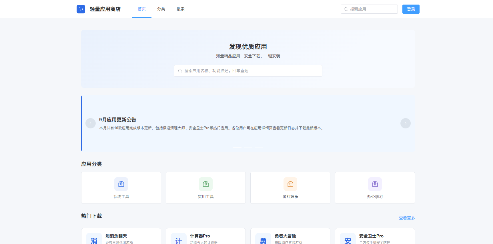

# 轻量应用商店 AppStore

> 一个覆盖应用分发全链路的全栈项目：Spring Boot 后端 + 用户端 / 作者端 / 管理端三套 Vue 3 前端。
> 当前版本：**v1.3.0（企业级增强版）**



## 目录

- [一、项目简介](#一项目简介)
- [二、功能特性](#二功能特性)
- [三、技术栈](#三技术栈)
- [四、目录结构](#四目录结构)
- [五、环境要求与端口规划](#五环境要求与端口规划)
- [六、快速开始](#六快速开始)
- [七、账号与凭据归档](#七账号与凭据归档)
- [八、配置说明](#八配置说明)
- [九、操作手册](#九操作手册)
- [十、接口文档](#十接口文档)
- [十一、数据库设计](#十一数据库设计)
- [十二、部署](#十二部署)
- [十三、日志、审计与监控](#十三日志审计与监控)
- [十四、测试与验证](#十四测试与验证)
- [十五、常见问题排查](#十五常见问题排查)
- [十六、版本更新日志](#十六版本更新日志)
- [十七、安全建议](#十七安全建议)
- [十八、说明](#十八说明)

---

## 一、项目简介

- **项目定位**：轻量应用商店是一个面向应用分发场景的全栈项目，包含**用户端、作者端、管理端三个独立前端**与一个**统一后端服务**，适合全栈学习、毕业设计与技术方案参考。
- **三端职责**：


| 端     | 目录              | 端口 | 角色     | 核心职责                                          |
| ------ | ----------------- | ---- | -------- | ------------------------------------------------- |
| 用户端 | `frontend-user`   | 5176 | 普通用户 | 浏览、搜索、下载、评分、评论、收藏应用            |
| 作者端 | `frontend-author` | 5174 | 应用作者 | 上传 / 管理应用与版本，查看下载统计               |
| 管理端 | `frontend-admin`  | 5175 | 管理员   | 应用 / 版本审核、用户 / 分类 / 公告管理与数据大盘 |

- **核心业务闭环**：作者提交应用 → 管理员审核 → 应用上架 → 用户浏览 / 下载 / 评价 → 作者查看统计 → 持续迭代版本。
- **项目特点**：
  - 分端真实的业务建模，覆盖审核流、防刷防爆破、可见性收敛、字段白名单等企业级问题；
  - JWT 认证 + 路径级权限拦截、AOP 操作审计落盘、Swagger 3 在线调试、Prometheus 监控；
  - Docker Compose 一键部署、GitHub Actions CI、36 个单元测试。
- **业务边界**：
  - 已完成：注册登录、应用浏览 / 搜索 / 详情、下载（含防刷）、评分评论（含 XSS 清洗）、收藏、应用与版本上传、两级分类、审核流（防重复）、用户管理、公告管理、三端统计、修改密码、资料编辑。
  - 预留扩展（未开放 UI）：评论二级回复（`parent_id` 已留）、分类图标、安装包完整性校验（`file_md5` 已留）、RBAC 四张权限表。

---

## 二、功能特性

### 2.1 用户端（http://localhost:5176）

- 首页：公告轮播（点击查看详情）、分类导航、热门应用（Redis 缓存 5 分钟）、最新上架。
- 分类浏览：一级 / 二级分类筛选 + 分页；关键词搜索（名称 / 简介模糊匹配）。
- 应用详情：版本记录（仅已过审版本）、评分、下载、收藏。
- 我的下载（按应用去重 + SQL 分页）、我的收藏（SQL 分页）。
- 个人中心：编辑资料、修改密码；登录注册 + 登录防爆破。

### 2.2 作者端（http://localhost:5174）

- 数据概览：我的应用数 / 本人待审核数 / 累计总下载量。
- 应用管理：上传应用、应用列表、编辑（改动自动重置待审核 + 字段白名单防篡改）、删除（仅本人）。
- 版本管理：上传新版本（`versionCode` 自动 +1、更新强制重审）、版本记录管理。
- 个人资料（含改密）、平台公告查看。

### 2.3 管理端（http://localhost:5175）

- 数据大盘：用户 / 今日新增、应用 / 待审核、下载总量 / 今日下载、评论 / 公告统计（ECharts 可视化）。
- 用户管理：搜索筛选、启用禁用（禁用立即失效）、删除（防自删）。
- 分类管理：两级分类增删改（防循环层级、防降级、有关联不可删）。
- 应用审核 / 版本审核：审核记录落盘、防重复审核、通过后自动同步版本信息。
- 公告管理：发布 / 草稿 / 编辑 / 删除（草稿对外不可见 + XSS 清洗）。

### 2.4 平台级能力（v1.3 企业级增强）

- **操作审计**：AOP 自动拦截控制器写操作，JSON 单行记录落盘 `logs/audit.log`（保留 90 天，敏感字段脱敏）。
- **企业级日志**：Logback 三通道滚动日志（app / error / audit，按天 + 大小滚动，异步写入）。
- **在线接口文档**：Swagger 3（支持 Authorize 携带 Bearer Token 调试）。
- **运维监控**：Actuator 暴露 health / info / metrics / prometheus，可对接 Prometheus。
- **容器化部署**：后端多阶段 Dockerfile（非 root + 健康检查）+ 三前端 Nginx 镜像 + docker-compose 一键拉起。
- **CI 流水线**：GitHub Actions（后端测试打包 → 三前端构建 → Docker 镜像冒烟构建）。
- **前端工程化**：三端接入 ESLint 9 Flat Config + Prettier（lint / lint:check / format）。

---

## 三、技术栈


| 分类               | 组件                     | 版本 / 说明                                                             |
| ------------------ | ------------------------ | ----------------------------------------------------------------------- |
| **后端**           | Java / Spring Boot       | 17 / 2.7.18                                                             |
|                    | MyBatis-Plus             | 3.5.5                                                                   |
|                    | MySQL Connector-J        | 8.0.33                                                                  |
|                    | 认证与安全               | JJWT 0.11.5 + BCrypt（Hutool 5.8.25）                                   |
|                    | 操作审计                 | spring-boot-starter-aop（注解`@OperateLog` + 切面）                     |
|                    | 在线文档                 | springdoc-openapi-ui 1.7.0（Swagger 3）                                 |
|                    | 监控                     | spring-boot-starter-actuator + micrometer-registry-prometheus           |
|                    | 测试                     | JUnit Jupiter 5.8.2 + Mockito 4.5.1（36 用例）                          |
|                    | 构建                     | Maven 3.6+（产物`appstore-backend-1.0.0.jar`）                          |
| **前端**           | Vue / Vue Router / Vite  | 3.4.21 / 4.3.0 / 5.1.6                                                  |
|                    | Element Plus（按需引入） | 2.6.1（icons 2.3.1，unplugin-vue-components）                           |
|                    | Pinia / Axios            | 2.1.7 / 1.6.7                                                           |
|                    | 可视化（管理端）         | ECharts 5.5.0                                                           |
|                    | 工程化（三端统一）       | ESLint 9.39.4 + Prettier 3.9.10                                         |
| **数据库与中间件** | MySQL                    | 8.0（InnoDB / utf8mb4，13 张表）                                        |
|                    | Redis                    | 7（容器）或 3.x+（本地），端口 6379                                     |
|                    | Redis 用途               | 热门应用缓存（5 分钟）、下载 IP 防刷、登录防爆破锁定                    |
| **开发与运维**     | 容器化                   | Docker / Docker Compose（mysql:8.0、redis:7-alpine、nginx:1.25-alpine） |
|                    | 反向代理                 | Nginx 1.25（Gzip / 强缓存 / SPA 回退 / 反代）                           |
|                    | CI/CD                    | GitHub Actions（backend-test / frontend-build / docker-build）          |
|                    | 接口调试                 | Swagger UI / OpenAPI 3.0                                                |

---

## 四、目录结构

```
AppStore/
├── backend/                         # 后端（Spring Boot 单体服务）
│   ├── src/main/java/com/appstore/
│   │   ├── controller/              # 12 个控制器（约 50 个 REST 接口）
│   │   ├── service/ + impl/         # 11 个业务服务
│   │   ├── mapper/ / entity/        # 10 个 Mapper / 10 个实体（对应 13 张表）
│   │   ├── dto/ / vo/               # 入参与出参对象
│   │   ├── config/                  # 7 个配置类（CORS / Redis / MyBatis / Swagger 等）
│   │   ├── interceptor/             # JwtInterceptor（认证 + 路径级权限）
│   │   ├── aspect/ + annotation/    # AOP 操作审计（@OperateLog）
│   │   └── common/ / exception/     # Result 统一返回、ResultCode、全局异常
│   ├── src/main/resources/          # application.yml、logback-spring.xml
│   └── src/test/java/               # 7 个单元测试类（36 用例，无需数据库 / Redis）
├── frontend-user/                   # 用户端（Vue 3 + Vite，5173）
├── frontend-author/                 # 作者端（Vue 3 + Vite，5174）
├── frontend-admin/                  # 管理端（Vue 3 + Vite + ECharts，5175）
├── database/                        # init.sql（全量初始化）、upgrade.sql（增量升级）
├── deploy/nginx/default.conf        # 前端镜像共用的 Nginx 配置
├── sql/appstore.sql                 # 历史 Navicat 导出（与 database/init.sql 重复，仅供参考）
├── uploads/                         # 上传文件目录（icons / apps / avatars）
├── .github/workflows/ci.yml         # CI 流水线
├── docker-compose.yml               # 容器化一键部署（MySQL / Redis / 后端 / 三前端）
├── .env.example                     # 环境变量模板（JWT 密钥、数据库密码外置）
├── start-all.bat                    # Windows 一键启动（MySQL 自动探测）
├── stop-all.bat                     # Windows 一键停止（按端口精准停止）
└── .npm_cache/                      # npm 依赖本地缓存（离线加速用）
```

---

## 五、环境要求与端口规划


| 软件     | 版本要求                                                | 用途                 | 验证命令          |
| -------- | ------------------------------------------------------- | -------------------- | ----------------- |
| JDK      | 17+                                                     | 后端运行             | `java -version`   |
| Maven    | 3.6+                                                    | 后端构建             | `mvn -version`    |
| Node.js  | 18+（推荐 20）                                          | 前端构建与开发       | `node -v`         |
| MySQL    | 8.0（3306）                                             | 业务数据             | `mysql --version` |
| Redis    | 3.x+ / 7（6379）                                        | 缓存 / 防刷 / 防爆破 | `redis-cli ping`  |
| 操作系统 | Windows 10+（一键脚本）；Linux / macOS 手动命令同等可行 | —                   | —                |

端口规划：


| 服务   | 开发端口                   | Docker 端口  |
| ------ | -------------------------- | ------------ |
| MySQL  | 3306                       | 3307 → 3306 |
| Redis  | 6379                       | 6380 → 6379 |
| 后端   | 8080（context-path`/api`） | 内部 8080    |
| 用户端 | 5176                       | 8073         |
| 作者端 | 5174                       | 8074         |
| 管理端 | 5175                       | 8075         |

---

## 六、快速开始

### 6.1 初始化数据库（首次）

```bash
# 在项目根目录执行：建库 appstore + 13 张表 + 种子数据（会覆盖已有数据）
mysql -u root -p123456 < database/init.sql
```

- 默认连接本机 3306、`root/123456`；密码不同请调整命令或设置环境变量 `DB_PASSWORD`。
- 旧库（v1.0 → v1.1）执行增量升级（仅补 4 个索引，幂等）：

```bash
mysql -u root -p123456 < database/upgrade.sql
```

- v1.2 / v1.3 无数据库表结构变更，无需执行 SQL。
- 验证：

```sql
USE appstore;
SELECT COUNT(*) FROM sys_user;                    -- 期望 7
SELECT COUNT(*) FROM app_info WHERE deleted = 0;  -- 期望 10
```

### 6.2 准备 Redis

```bash
# Windows（路径按实际安装位置）
F:\Redis\redis-server.exe F:\Redis\redis.windows.conf

# Linux / macOS
sudo apt install redis-server
# 或容器
docker run -d -p 6379:6379 redis:7-alpine

# 验证
redis-cli ping   # 期望 PONG
```

> Redis 异常时：热门缓存自动回源数据库，登录防爆破降级放行，核心业务链路可用。

### 6.3 启动后端

**方式 A：一键脚本（Windows）**

双击项目根目录 `start-all.bat`，脚本依次：

1. 探测并启动 MySQL（未监听 3306 时，在常见目录中探测 `mysqld.exe`）；
2. 检测 / 启动 Redis（`redis-cli ping`）；
3. 清理 8080 / 5176 / 5174 / 5175 端口冲突进程；
4. 新窗口启动后端，随后依次启动三端前端。

**方式 B：手动启动**

```bash
cd backend
mvn spring-boot:run
```

启动成功标志：

```
Started AppStoreApplication in x.xxx seconds
Tomcat started on port 8080 (http) with context path '/api'
```

### 6.4 启动三端前端

三个前端分别开三个终端（首次需先安装依赖；项目自带 `.npm_cache` 本地缓存，可加 `--cache ../.npm_cache` 离线加速）：

```bash
cd frontend-user   && npm install --cache ../.npm_cache && npm run dev   # 5176
cd frontend-author && npm install --cache ../.npm_cache && npm run dev   # 5174
cd frontend-admin  && npm install --cache ../.npm_cache && npm run dev   # 5175
```

Vite 已内置代理：三端将 `/api` 与 `/uploads` 代理到 `http://localhost:8080`，开发时无需改代码。

### 6.5 启动结果验证


| 检查项       | 操作                                                          | 预期                                |
| ------------ | ------------------------------------------------------------- | ----------------------------------- |
| 后端接口     | 打开`http://localhost:8080/api/app/list?pageNum=1&pageSize=1` | 返回`{"code":200,...}`              |
| 健康检查     | 打开`http://localhost:8080/api/actuator/health`               | `"status":"UP"`，含 redis / db 状态 |
| 用户端       | 打开 http://localhost:5176                                    | 首页公告轮播、热门 / 最新应用       |
| 作者端       | 打开 http://localhost:5174 并登录                             | 作者账号可进入工作台                |
| 管理端       | 打开 http://localhost:5175 并登录                             | 管理员账号可进入数据大盘            |
| 在线接口文档 | `http://localhost:8080/api/swagger-ui/index.html`             | Swagger UI 正常打开                 |

停止运行：双击 `stop-all.bat`（按端口精准停止，不会误杀其他 Java / Node 程序；MySQL / Redis 有意保留）。

> **路径提示**：`start-all.bat` 内置 MySQL 探测目录、Redis 默认路径与项目绝对路径，`application.yml` 的默认上传目录也指向开发机绝对路径。克隆到其他目录时，请修改脚本内路径，或设置环境变量 `FILE_UPLOAD_PATH` 指向你的 `uploads/` 目录。

---

## 七、账号与凭据归档

### 7.1 种子账号（`database/init.sql`）

所有种子账号密码均为 **`123456`**，数据库中存储的是同一个 BCrypt 哈希：

```
$2a$10$BG6eVxVTQQ3PHiV0hqYuSuxOJpli8ZosaVlQtUu.5FTsYkoIhdIf.
```


| 用户名  | 密码   | 角色     | userType | 昵称       | 邮箱                 | 手机号      |
| ------- | ------ | -------- | -------- | ---------- | -------------------- | ----------- |
| user1   | 123456 | 普通用户 | 1        | 张三       | zhangsan@example.com | 13800138001 |
| user2   | 123456 | 普通用户 | 1        | 李四       | lisi@example.com     | 13800138002 |
| author1 | 123456 | 作者     | 2        | 王开发者   | wangdev@example.com  | 13900139001 |
| author2 | 123456 | 作者     | 2        | 李工作室   | listudio@example.com | 13900139002 |
| author3 | 123456 | 作者     | 2        | 赵科技     | zhaotech@example.com | 13900139003 |
| admin   | 123456 | 管理员   | 3        | 超级管理员 | admin@example.com    | 13700137000 |
| admin2  | 123456 | 管理员   | 3        | 审核员小李 | admin2@example.com   | 13700137002 |

登录入口与可用账号：


| 端     | 地址                  | 可用账号                                    |
| ------ | --------------------- | ------------------------------------------- |
| 用户端 | http://localhost:5176 | user1 / user2（也支持作者、管理员登录浏览） |
| 作者端 | http://localhost:5174 | author1 / author2 / author3（管理员亦可）   |
| 管理端 | http://localhost:5175 | admin / admin2                              |

> token 有效期 24 小时；同一用户名连续登录失败 5 次将锁定 10 分钟（Redis 实现）。

### 7.2 基础设施凭据


| 组件  | 地址           | 用户名 | 密码   | 说明             |
| ----- | -------------- | ------ | ------ | ---------------- |
| MySQL | localhost:3306 | root   | 123456 | 数据库`appstore` |
| Redis | localhost:6379 | —     | 无密码 | 本地默认配置     |

> 以上均为**开发 / 演示环境默认凭据**。正式上线前必须全部更换，详见[十七、安全建议](#十七安全建议)。

---

## 八、配置说明

### 8.1 环境变量

配置文件：`backend/src/main/resources/application.yml`（支持环境变量覆盖，便于容器化异构部署）。


| 变量                          | 默认值                                       | 说明                                           |
| ----------------------------- | -------------------------------------------- | ---------------------------------------------- |
| `SPRING_PROFILES_ACTIVE`      | dev                                          | 运行环境                                       |
| `DB_HOST` / `DB_PORT`         | localhost / 3306                             | MySQL 地址 / 端口                              |
| `DB_USERNAME` / `DB_PASSWORD` | root / 123456                                | MySQL 账号 / 密码                              |
| `REDIS_HOST` / `REDIS_PORT`   | localhost / 6379                             | Redis 地址 / 端口                              |
| `JWT_SECRET`                  | 内置默认值                                   | JWT 签名密钥（生产必须替换为 64 位以上随机串） |
| `FILE_UPLOAD_PATH`            | `F:/AI_full-stack_project/AppStore/uploads/` | 上传文件目录（容器内`/data/uploads/`）         |
| `SPRINGDOC_ENABLED`           | true                                         | Swagger 开关                                   |

Windows 设置用户级永久变量（重开终端生效）：

```cmd
setx JWT_SECRET "你的64位以上随机密钥"
setx DB_PASSWORD "你的数据库密码"
```

### 8.2 前端代理

三端 `vite.config.js` 均将 `/api`、`/uploads` 代理至 `http://localhost:8080`；后端换端口时需同步修改。

### 8.3 上传限制


| 类型            | 允许格式                      | 大小上限 |
| --------------- | ----------------------------- | -------- |
| 应用图标 / 头像 | jpg / jpeg / png / gif / webp | 5MB      |
| 安装包          | apk / exe / zip / rar         | 500MB    |

上传目录白名单仅 `icons` / `apps` / `avatars`（防路径穿越）；危险扩展名（jsp / php / sh / bat / html / js 等）一律拒绝；图片额外做 MIME 二次校验。

---

## 九、操作手册

### 9.1 用户端

**注册与登录**：首页右上角「登录」；无账号点击「立即注册」（用户名以字母开头 3-20 位，密码 6-20 位，邮箱 / 手机号选填）。

**浏览与搜索**：首页公告轮播（可查看详情）、分类导航、热门应用、最新上架；分类页按一级 → 二级筛选并分页；顶部搜索框按名称 / 简介匹配。

**应用详情**：查看简介、评分、下载量、版本记录（仅已上架版本）、用户评价；下载需登录并计入下载量；收藏可随时取消。

**发表评价**：选择 1-5 星并填写内容（≤500 字），发表后实时计入平均分。

**个人中心**：编辑昵称 / 邮箱 / 手机号；修改密码（原密码校验，成功需重新登录）；查看去重后的下载记录；管理我的收藏。

### 9.2 作者端

**数据概览**：我的应用数、本人待审核数、本人全部应用累计下载量。

**上传新应用**：「我的应用」→「上传新应用」，填写名称、一级 / 二级分类、图标、简短描述、详细描述，提交后进入待审核。

**管理应用**：编辑后自动重新进入待审核；仅能删除自己的应用；可为应用上传新版本（版本号如 2.6.0，安装包 ≤500MB），提交后待审核。

**审核状态**：


| 状态   | 含义                 | 下一步                       |
| ------ | -------------------- | ---------------------------- |
| 待审核 | 管理员尚未处理       | 等待审核                     |
| 已通过 | 应用已上架，用户可见 | 可在用户端查看               |
| 已拒绝 | 审核未通过           | 查看审核意见，修改后重新提交 |

**个人资料**：编辑昵称 / 邮箱 / 手机号 / 头像；修改密码需原密码验证。

### 9.3 管理端

**数据大盘**：用户总数 / 今日新增、应用总数 / 待审核数、下载总数 / 今日下载、评论总数 / 公告数。

**用户管理**：按关键词、用户类型筛选；启用 / 禁用（禁用立即生效）；删除（不能删除当前登录的自己）。

**分类管理**：新增一级分类；为一级分类添加二级分类；编辑 / 删除（有子分类或关联应用时不可删除）。

**应用审核**：按状态筛选 → 查看详情 → 通过 / 拒绝（可填审核意见）；已审核应用不会再次出现在可操作状态。

**版本审核**：输入应用 ID 查询版本列表，对待审核版本通过 / 拒绝；通过后自动同步应用当前版本号与大小。

**公告管理**：填写标题、类型（系统 / 更新 / 活动）、内容、状态（发布 / 草稿）；已发布公告在用户端首页轮播展示。

### 9.4 业务规则速查


| 场景             | 规则                                                |
| ---------------- | --------------------------------------------------- |
| 注册用户类型     | 只能注册普通用户 / 作者，禁止注册管理员             |
| 应用上架         | 必须管理员审核通过后才对用户可见                    |
| 修改应用         | 修改后重置为待审核；下载量 / 评分等敏感字段不可修改 |
| 修改版本         | 修改后重置为待审核；版本编码 / 发布时间不可修改     |
| 删除应用 / 版本  | 仅作者本人或管理员                                  |
| 删除评论         | 仅评论者本人或管理员                                |
| 禁用用户         | 不能禁用 / 删除自己                                 |
| 下载量           | 同一 IP 同一应用 1 分钟只计一次                     |
| 评论评分         | 1-5 星，内容经 XSS 清洗，平均分原子更新             |
| 密码存储         | BCrypt 加密，接口永不返回密码                       |
| 登录防爆破       | 连续失败 5 次锁定 10 分钟                           |
| 未上架内容可见性 | 未过审版本 / 未上架应用详情仅作者本人与管理员可见   |

---

## 十、接口文档

### 10.1 通用约定

**Base URL**：`http://localhost:8080/api`

**统一返回格式**（业务异常也返回 HTTP 200，通过 `code` 区分）：

```json
{ "code": 200, "message": "操作成功", "data": {} }
```

**业务码**：


| code | 含义                                               |
| ---- | -------------------------------------------------- |
| 200  | 成功                                               |
| 400  | 参数错误（含格式校验失败、数字转换失败、非法参数） |
| 401  | 未登录 / 登录过期                                  |
| 403  | 无权限                                             |
| 404  | 资源不存在                                         |
| 500  | 系统内部错误                                       |
| 1001 | 用户不存在（登录失败）                             |
| 1002 | 密码错误（登录失败）                               |
| 1003 | 用户名已存在（注册冲突）                           |
| 1004 | 账号已被禁用（令牌即时失效）                       |
| 2001 | 应用不存在                                         |
| 2002 | 应用已存在                                         |
| 2003 | 版本号错误                                         |
| 3001 | 文件上传失败                                       |
| 3002 | 文件格式不支持                                     |
| 3003 | 文件大小超出限制                                   |
| 4001 | 审核操作失败                                       |

**认证方式**：除公开接口外，请求头携带 `Authorization: Bearer <token>`（登录接口返回，有效期 24 小时）。

**分页参数**：`pageNum`（默认 1）、`pageSize`（默认 10，最大 100）。

**角色**：普通用户 `userType=1`、作者 `userType=2`、管理员 `userType=3`。权限由后端 `JwtInterceptor` 统一拦截，前端隐藏按钮仅为体验优化。

### 10.2 认证接口 `/auth`


| 接口             | 方法 | 权限 | 说明                                                                                |
| ---------------- | ---- | ---- | ----------------------------------------------------------------------------------- |
| `/auth/login`    | POST | 公开 | 登录，返回 token / userId / username / nickname / userType / avatar / email / phone |
| `/auth/register` | POST | 公开 | 注册；`userType` 仅允许 1 / 2，传 3 拒绝（防提权）                                  |
| `/auth/info`     | GET  | 登录 | 获取当前用户信息                                                                    |
| `/auth/profile`  | PUT  | 登录 | 更新昵称 / 邮箱 / 手机 / 头像，不可改用户名、密码、角色                             |
| `/auth/password` | PUT  | 登录 | 修改密码（校验原密码，新旧不能相同）                                                |

注册校验：用户名必填、字母开头 3-20 位（字母 / 数字 / 下划线）；密码 6-20 位；邮箱、手机号选填但需符合格式。

### 10.3 应用接口 `/app`


| 接口               | 方法   | 权限              | 说明                                                        |
| ------------------ | ------ | ----------------- | ----------------------------------------------------------- |
| `/app/list`        | GET    | 公开              | 应用列表，仅已上架且审核通过，按下载量倒序，SQL 分页        |
| `/app/detail/{id}` | GET    | 公开（可选认证）  | 详情 + 分类名 + 作者昵称；未上架应用仅作者本人 / 管理员可见 |
| `/app/hot`         | GET    | 公开              | 热门应用（Redis 缓存 5 分钟），`limit` 默认 6               |
| `/app/new`         | GET    | 公开              | 最新上架，`limit` 默认 6                                    |
| `/app/search`      | GET    | 公开              | 按名称 / 简介模糊搜索，SQL 分页                             |
| `/app/add`         | POST   | 作者 / 管理员     | 上传应用，提交后`auditStatus=0`                             |
| `/app/update`      | PUT    | 作者本人 / 管理员 | 修改后重置待审核；字段白名单见下                            |
| `/app/delete/{id}` | DELETE | 作者本人 / 管理员 | 越权删除返回 403                                            |
| `/app/author/list` | GET    | 作者              | 作者本人应用分页列表                                        |
| `/app/audit/list`  | GET    | 管理员            | 审核列表，可按`auditStatus` 筛选                            |

`/app/update` 字段白名单：`authorId`、`downloadCount`、`rating`、`ratingCount`、`version`、`size`、`status`、`auditStatus` 不允许修改（服务端强制置空）。

`/app/detail/**`、`/notice/list`、`/notice/detail/**`、`/version/list/**` 为**可选认证**接口：携带有效 token 时解析用户上下文，未携带时按游客放行。

### 10.4 版本接口 `/version`


| 接口                    | 方法   | 权限              | 说明                                                                                       |
| ----------------------- | ------ | ----------------- | ------------------------------------------------------------------------------------------ |
| `/version/list/{appId}` | GET    | 公开（可选认证）  | `status=1` 仅已过审版本（用户端）；不带 `status` 仅作者本人 / 管理员可用，其余 403         |
| `/version/add`          | POST   | 作者 / 管理员     | `versionNo` 格式校验；`versionCode` 自动生成（最大 +1）；`fileUrl` 仅允许 `/uploads/` 开头 |
| `/version/update`       | PUT    | 作者本人 / 管理员 | 修改文件 / 更新日志后强制重置待审核；`updateLog` ≤500 字                                  |
| `/version/delete/{id}`  | DELETE | 作者本人 / 管理员 | 删除版本                                                                                   |

`/version/update` 字段白名单：`appId`、`versionCode`、`status`、`publishTime` 不允许修改。

### 10.5 下载接口 `/download`


| 接口                | 方法 | 权限 | 说明                                                 |
| ------------------- | ---- | ---- | ---------------------------------------------------- |
| `/download/{appId}` | POST | 登录 | 仅可下载已上架应用；返回安装包相对路径；写入下载记录 |
| `/download/my`      | GET  | 登录 | 我的下载记录，按应用去重，SQL 分页                   |

防刷：同一 IP 同一应用 1 分钟内只计一次下载量（Redis）。

### 10.6 评论接口 `/comment`


| 接口                    | 方法   | 权限          | 说明                                                                    |
| ----------------------- | ------ | ------------- | ----------------------------------------------------------------------- |
| `/comment/list/{appId}` | GET    | 公开          | 应用评论列表                                                            |
| `/comment/add`          | POST   | 登录          | `appId` 必填且应用已上架；`rating` 1-5；`content` ≤500 字并做 XSS 清洗 |
| `/comment/delete/{id}`  | DELETE | 本人 / 管理员 | 删除评论                                                                |

发表成功后通过单条原子 SQL 同时完成 `rating_count+1` 与平均分重算。

### 10.7 收藏接口 `/favorite`


| 接口                       | 方法   | 权限 | 说明                     |
| -------------------------- | ------ | ---- | ------------------------ |
| `/favorite/add/{appId}`    | POST   | 登录 | 收藏（重复收藏自动忽略） |
| `/favorite/cancel/{appId}` | DELETE | 登录 | 取消收藏                 |
| `/favorite/check/{appId}`  | GET    | 登录 | 是否已收藏               |
| `/favorite/my`             | GET    | 登录 | 我的收藏分页列表         |

### 10.8 分类接口 `/category`


| 接口                       | 方法   | 权限   | 说明                           |
| -------------------------- | ------ | ------ | ------------------------------ |
| `/category/list`           | GET    | 公开   | 全部分类（按排序）             |
| `/category/sub/{parentId}` | GET    | 公开   | 二级分类                       |
| `/category/add`            | POST   | 管理员 | 新增分类（校验两级结构）       |
| `/category/update`         | PUT    | 管理员 | 修改分类（防循环层级、防降级） |
| `/category/delete/{id}`    | DELETE | 管理员 | 有子分类 / 关联应用时拒绝删除  |

### 10.9 公告接口 `/notice`


| 接口                  | 方法   | 权限   | 说明                                                                              |
| --------------------- | ------ | ------ | --------------------------------------------------------------------------------- |
| `/notice/list`        | GET    | 公开   | `status` 不传 = 已发布；0 = 草稿；-1 = 全部。普通用户即使传 0 / -1 也只返回已发布 |
| `/notice/detail/{id}` | GET    | 公开   | 草稿详情对非管理员返回空                                                          |
| `/notice/add`         | POST   | 管理员 | 标题 1-100 字，内容 XSS 清洗                                                      |
| `/notice/update`      | PUT    | 管理员 | 内容 XSS 清洗；草稿转发布自动补发布时间                                           |
| `/notice/delete/{id}` | DELETE | 管理员 | 删除公告                                                                          |

### 10.10 用户管理接口 `/user`（管理员）


| 接口                | 方法   | 说明                                                   |
| ------------------- | ------ | ------------------------------------------------------ |
| `/user/list`        | GET    | 分页列表，支持`keyword` / `userType` 筛选，密码脱敏    |
| `/user/{id}`        | GET    | 用户详情（密码脱敏）                                   |
| `/user/update`      | PUT    | 修改昵称 / 邮箱 / 手机号（不可改密码 / 用户名 / 角色） |
| `/user/status`      | PUT    | 启用 / 禁用，如`{"id":1,"status":1}`，不能禁用自己     |
| `/user/delete/{id}` | DELETE | 删除用户，不能删除自己                                 |

### 10.11 审核接口 `/audit`（管理员）


| 接口             | 方法 | 说明                                                                                               |
| ---------------- | ---- | -------------------------------------------------------------------------------------------------- |
| `/audit/app`     | POST | 应用审核：`{"appId":1,"auditResult":2,"auditRemark":"审核通过"}`；`auditResult` 2 = 通过、3 = 拒绝 |
| `/audit/version` | POST | 版本审核：`{"versionId":1,"auditResult":2}`；通过后自动同步应用版本号与大小                        |

审核通过 → 应用上架（`status=1`）；拒绝 → 下架（`status=2`）；已审核应用不可重复审核；审核记录写入 `app_audit`（表内 `audit_result` 1 = 通过、2 = 拒绝）。

### 10.12 文件上传接口 `/file`（登录）


| 接口                       | 说明                                                            |
| -------------------------- | --------------------------------------------------------------- |
| `/file/upload/icon`        | 图标上传（jpg / jpeg / png / gif / webp，≤5MB，MIME 二次校验） |
| `/file/upload/apk`         | 安装包上传（apk / exe / zip / rar，≤500MB）                    |
| `/file/upload/{directory}` | 通用上传，`directory` 仅 `icons` / `apps` / `avatars`           |

### 10.13 统计接口 `/statistics`


| 接口                    | 权限   | 返回字段                                                                                                            |
| ----------------------- | ------ | ------------------------------------------------------------------------------------------------------------------- |
| `/statistics/dashboard` | 管理员 | userCount、todayNewUsers、appCount、pendingAuditCount、downloadCount、todayDownloadCount、commentCount、noticeCount |
| `/statistics/author`    | 作者   | myAppCount、myDownloadCount、pendingAuditCount                                                                      |

### 10.14 错误示例

```json
{ "code": 401, "message": "未登录或登录已过期" }
{ "code": 403, "message": "没有权限执行该操作" }
{ "code": 400, "message": "用户名需以字母开头，长度3-20位，只能包含字母、数字、下划线；密码长度需在6-20位之间" }
```

---

## 十一、数据库设计

### 11.1 概览

- 库名：`appstore`；字符集 `utf8mb4`；排序规则 `utf8mb4_unicode_ci`；引擎 InnoDB。
- 表数量：**13 张**（9 张业务表 + 4 张 RBAC 权限表）。
- 初始化脚本：`database/init.sql`（建库建表 + 种子数据）。
- 升级脚本：`database/upgrade.sql`（v1.0 → v1.1 增量补索引，幂等）。

### 11.2 表清单


| 表名                | 中文名         | 说明                                       |
| ------------------- | -------------- | ------------------------------------------ |
| sys_user            | 用户表         | 普通用户 / 作者 / 管理员，密码 BCrypt 加密 |
| sys_role            | 角色表         | 系统角色定义（预留扩展）                   |
| sys_permission      | 权限表         | RBAC 权限定义（预留扩展）                  |
| sys_role_permission | 角色权限关联表 | RBAC 关联（预留扩展）                      |
| sys_user_role       | 用户角色关联表 | RBAC 关联（预留扩展）                      |
| app_category        | 分类表         | 一级 / 二级两级分类（`parent_id`）         |
| app_info            | 应用信息表     | 应用主表，含审核状态、下载量、评分         |
| app_version         | 应用版本表     | 版本号、版本编码、文件地址、审核状态       |
| app_audit           | 审核记录表     | 应用 / 版本审核日志                        |
| app_comment         | 评论表         | 用户评分与评论                             |
| app_download        | 下载记录表     | 用户下载日志                               |
| app_favorite        | 收藏表         | 用户收藏（`user_id + app_id` 唯一）        |
| sys_notice          | 公告表         | 系统 / 更新 / 活动公告                     |

> RBAC 四张表为**预留扩展**，当前业务以 `sys_user.user_type` 区分角色（1 普通用户 / 2 作者 / 3 管理员），两套体系并存、互不冲突。

### 11.3 核心表字段

**sys_user 用户表**：`id`、`username`(UNIQUE)、`password`(BCrypt)、`nickname`、`email`、`phone`、`avatar`、`user_type`(1/2/3)、`status`(0 禁用 / 1 正常)、`create_time`、`update_time`、`deleted`。

**app_info 应用信息表**：`id`、`app_name`、`app_icon`、`category_id`、`sub_category_id`、`author_id`、`description`、`short_desc`、`version`、`size`、`download_count`、`rating`、`rating_count`、`status`(0 待审核 / 1 已通过 / 2 已拒绝 / 3 已下架)、`audit_status`(0 待审核 / 1 审核中 / 2 已通过 / 3 已拒绝)、`screenshots`、`create_time`、`update_time`、`deleted`。
索引：`idx_category_id`、`idx_author_id`、`idx_status`、`idx_audit_status`、`idx_download_count`。

**app_version 应用版本表**：`id`、`app_id`、`version_no`、`version_code`、`file_url`、`file_size`、`file_md5`、`update_log`、`status`(0 待审核 / 1 已通过 / 2 已拒绝)、`publish_time`、`create_time`、`update_time`、`deleted`。
索引：`idx_app_id`、`idx_version_no`、`idx_status`。

**app_audit 审核记录表**：`id`、`app_id`、`version_id`、`auditor_id`、`audit_type`(1 应用 / 2 版本)、`audit_result`(1 通过 / 2 拒绝)、`audit_remark`、`audit_time`、`create_time`。

**app_comment 评论表**：`id`、`app_id`、`user_id`、`content`、`rating`(1-5)、`parent_id`、`like_count`、`status`、`create_time`、`update_time`、`deleted`。
索引：`idx_app_id`、`idx_user_id`、`idx_parent_id`、`idx_app_status (app_id, status)`。

**app_download 下载记录表**：`id`、`user_id`、`app_id`、`version_id`、`download_time`、`ip`。
索引：`idx_app_id`、`idx_download_time`、`idx_user_app (user_id, app_id)`。

**app_favorite 收藏表**：`id`、`user_id`、`app_id`、`create_time`，唯一键 `uk_user_app (user_id, app_id)`。

**sys_notice 公告表**：`id`、`title`、`content`、`notice_type`(1 系统 / 2 更新 / 3 活动)、`status`(0 草稿 / 1 已发布)、`publisher_id`、`publish_time`、`create_time`、`update_time`、`deleted`。

**app_category 分类表**：`id`、`parent_id`(0 = 一级)、`category_name`、`category_icon`、`sort_order`、`status`、`create_time`、`update_time`、`deleted`；仅支持两级。

### 11.4 数据关系

```
sys_user (1) ──< (N) app_info >── (N) app_version
sys_user (1) ──< (N) app_comment >── (1) app_info
sys_user (1) ──< (N) app_download >── (1) app_info
sys_user (1) ──< (N) app_favorite >── (1) app_info
sys_user (1) ──< (N) app_audit >── (1) app_info
app_category (1) ──< (N) app_info        （category_id / sub_category_id）
app_category (1) ──< (N) app_category    （parent_id，二级分类）
```

### 11.5 索引与优化

- v1.1 新增：`app_info.idx_audit_status`、`app_version.idx_status`、`app_comment.idx_app_status`、`app_download.idx_user_app`。
- v1.2 清理冗余索引（仅影响全新初始化）：移除 `sys_user.idx_username`（UNIQUE 已建索引）、`app_favorite.idx_user_id`、`app_download.idx_user_id`（均被联合索引最左前缀覆盖）。

### 11.6 种子数据

7 个账号、12 个分类、10 个应用、10 个版本、12 条评论、3 条公告，以及下载 / 收藏 / 审核记录。

---

## 十二、部署

### 12.1 部署架构

- **开发环境**：后端 `mvn spring-boot:run`（8080），三端 `npm run dev`（5176 / 5174 / 5175），Vite 代理 `/api` 与 `/uploads`。
- **生产环境**：后端 JAR 运行（或容器化），三端 `npm run build` 静态产物由 Nginx 托管并反向代理 `/api` 与 `/uploads`；也可全部由 Docker Compose 编排。

服务器建议最低 2 核 4G（推荐 4 核 8G；APK 上限 500MB，需评估磁盘与带宽）。

### 12.2 手工部署

**初始化数据库**：

```bash
mysql -u <用户名> -p < database/init.sql
```

已有 v1.0 数据再执行 `database/upgrade.sql`（v1.2 / v1.3 无表结构变更）。

**后端打包与运行**：

```bash
cd backend
mvn clean package -DskipTests
# 产物：backend/target/appstore-backend-1.0.0.jar
```

生产必须外置敏感配置：

```bash
export SPRING_PROFILES_ACTIVE=prod
export DB_HOST=127.0.0.1 DB_USERNAME=<用户名> DB_PASSWORD=<强密码>
export REDIS_HOST=127.0.0.1
export JWT_SECRET="<64位以上随机字符串>"
export FILE_UPLOAD_PATH=/data/appstore/uploads/
export SPRINGDOC_ENABLED=false
java -jar target/appstore-backend-1.0.0.jar
```

**systemd 常驻示例**：

```ini
# /etc/systemd/system/appstore.service
[Unit]
Description=AppStore Backend (Spring Boot)
After=network.target mysql.service redis.service

[Service]
Type=simple
User=www-data
WorkingDirectory=/data/appstore
ExecStart=/usr/bin/java -jar /data/appstore/appstore-backend-1.0.0.jar
Environment=SPRING_PROFILES_ACTIVE=prod
Environment=DB_HOST=127.0.0.1
Environment=DB_PORT=3306
Environment=DB_USERNAME=appstore
Environment=DB_PASSWORD=<强密码>
Environment=REDIS_HOST=127.0.0.1
Environment=REDIS_PORT=6379
Environment=JWT_SECRET=<64位以上随机字符串>
Environment=FILE_UPLOAD_PATH=/data/appstore/uploads/
Environment=SPRINGDOC_ENABLED=false
Restart=always
RestartSec=5

[Install]
WantedBy=multi-user.target
```

```bash
sudo systemctl daemon-reload
sudo systemctl enable --now appstore
sudo systemctl status appstore
```

**前端打包**：

```bash
cd frontend-user   && npm install && npm run build
cd frontend-author && npm install && npm run build
cd frontend-admin  && npm install && npm run build
```

将三个 `dist/` 上传到服务器（如 `/data/appstore/web-user`、`web-author`、`web-admin`）。

**Nginx 配置**（三端子域名方案，三个 `server` 块结构相同，仅 `server_name` 与 `root` 不同）：

```nginx
server {
    listen 80;
    server_name app.example.com;
    client_max_body_size 500m;

    location / {
        root /data/appstore/web-user;
        try_files $uri $uri/ /index.html;
    }

    location /api/ {
        proxy_pass http://127.0.0.1:8080/api/;
        proxy_set_header Host $host;
        proxy_set_header X-Real-IP $remote_addr;
        proxy_request_buffering off;
        proxy_read_timeout 300s;
        proxy_connect_timeout 30s;
    }

    location /uploads/ {
        proxy_pass http://127.0.0.1:8080/uploads/;
        proxy_read_timeout 120s;
    }
}

# 作者端 / 管理端：复制上方 server 块，替换：
#   server_name dev.example.com;   root /data/appstore/web-author;
#   server_name admin.example.com; root /data/appstore/web-admin;
```

可选优化：开启 `gzip`；`/assets/` 静态资源 1 年强缓存；`index.html` 不缓存。对外仅开放 80 / 443 与 SSH，`8080 / 3306 / 6379` 仅内网访问。

### 12.3 Docker Compose 一键部署

```bash
cp .env.example .env     # 修改生产密码与 JWT_SECRET
docker compose up -d --build
docker compose ps        # 等待 healthcheck 通过
```

服务与端口：


| 服务         | 镜像 / 构建                            | 对外端口     | 说明                                             |
| ------------ | -------------------------------------- | ------------ | ------------------------------------------------ |
| `mysql`      | mysql:8.0                              | 3307 → 3306 | 首次启动自动执行`database/init.sql`              |
| `redis`      | redis:7-alpine                         | 6380 → 6379 | 数据卷`redis-data`                               |
| `backend`    | ./backend 多阶段构建                   | 内部 8080    | 非 root、G1GC、HEALTHCHECK`/api/actuator/health` |
| `web-user`   | ./frontend-user → nginx:1.25-alpine   | 8073 → 80   | 反代`/api`、`/uploads`                           |
| `web-author` | ./frontend-author → nginx:1.25-alpine | 8074 → 80   | 同上                                             |
| `web-admin`  | ./frontend-admin → nginx:1.25-alpine  | 8075 → 80   | 同上                                             |

数据卷：`mysql-data`、`redis-data`、`uploads-data`、`backend-logs`。

常用运维：

```bash
docker compose logs -f backend
docker compose restart backend
docker compose down          # 停止（数据卷保留）
docker compose down -v       # ⚠️ 停止并删除数据卷（相当于清库）
```

### 12.4 CI 流水线

`.github/workflows/ci.yml`，`push` / `pull_request`（`main`、`master`）触发，3 个作业：

1. **后端测试与构建**：JDK 17 + `mvn -B verify`，上传 JAR 产物（保留 7 天）；
2. **前端构建**：矩阵并行三端，Node 20 + `npm ci` + `npm run build`；
3. **Docker 镜像冒烟构建**：`docker build ./backend` + `docker compose config -q`。

### 12.5 备份与恢复

```bash
# 备份（建议每日）
mysqldump -u <用户名> -p appstore > appstore_backup_$(date +%F).sql

# 恢复
mysql -u <用户名> -p appstore < appstore_backup.sql
```

同时拷贝 `uploads/` 目录（图片 / 安装包存文件系统而非数据库）。crontab 每日 03:00 示例：

```bash
0 3 * * * mysqldump -uappstore -p'<密码>' appstore > /data/backup/appstore_$(date +\%F).sql 2>/dev/null
```

### 12.6 部署验证清单

- [ ]  `/api/actuator/health` 返回 `{"status":"UP"}`。
- [ ]  `GET /api/app/list?pageNum=1&pageSize=1` 返回 `{"code":200,...}`。
- [ ]  三端均可打开页面且登录成功。
- [ ]  上传 / 下载链路正常（文件落在 `FILE_UPLOAD_PATH` 或卷 `uploads-data`）。
- [ ]  `logs/` 三类日志正常滚动，`audit.log` 有新记录。
- [ ]  数据库备份成功，仓库与产物不含 `.env` 等敏感文件。

---

## 十三、日志、审计与监控

### 13.1 日志

配置：`backend/src/main/resources/logback-spring.xml`，输出到后端工作目录 `logs/`。


| 文件                   | 内容               | 滚动策略                                            |
| ---------------------- | ------------------ | --------------------------------------------------- |
| `appstore-backend.log` | 全量运行日志       | 按天 + 100MB，gzip 归档，保留 30 天 / 5GB，异步写入 |
| `error.log`            | 仅 ERROR 级        | 50MB，保留 30 天 / 2GB                              |
| `audit.log`            | 操作审计 JSON 单行 | 50MB，保留 90 天 / 2GB                              |

### 13.2 操作审计

`OperateLogAspect` 自动拦截所有 Controller 的 POST / PUT / DELETE 写操作，以及标注 `@OperateLog(module, action)` 的方法。审计记录示例：

```json
{"time":"2026-10-23T15:19:12","userId":1,"username":"admin","module":"Auth","action":"login",
 "method":"POST","uri":"/api/auth/login","ip":"0.0.0.0","args":[{"username":"admin","password":"******"}],
 "result":200,"costMs":263,"error":null}
```

设计要点：审计失败绝不影响业务；密码等敏感字段自动脱敏；上传文件只记录文件名与大小；参数超过 1024 字符自动截断；审计通道独立（logger `OPERATE_AUDIT`），可接入 ELK / Splunk。

### 13.3 监控


| 端点                       | 用途                                 |
| -------------------------- | ------------------------------------ |
| `/api/actuator/health`     | 健康检查（含 DB / Redis / 磁盘状态） |
| `/api/actuator/metrics`    | JVM / HTTP / HikariCP / Redis 指标   |
| `/api/actuator/prometheus` | Prometheus 抓取格式指标              |
| `/api/actuator/info`       | 应用信息                             |

Prometheus 接入示例：

```yaml
scrape_configs:
  - job_name: appstore
    metrics_path: /api/actuator/prometheus
    static_configs:
      - targets: ['<backend-host>:8080']
```

### 13.4 在线接口文档


| 入口         | 地址                                              |
| ------------ | ------------------------------------------------- |
| Swagger UI   | `http://localhost:8080/api/swagger-ui/index.html` |
| OpenAPI JSON | `http://localhost:8080/api/v3/api-docs`           |

右上角 **Authorize** 粘贴登录返回的 token 即可调试受保护接口；生产设置 `SPRINGDOC_ENABLED=false` 关闭。

---

## 十四、测试与验证

### 14.1 单元测试

```bash
cd backend
mvn test
```

共 **7 个测试类、36 个用例**（Auth / AppInfo / AppVersion / Notice / File / JwtUtil / XssUtil），基于 JUnit 5 + Mockito，**无需数据库与 Redis**，覆盖登录防爆破、字段白名单、可见性收敛等安全加固点。预期输出 `Tests run: 36, Failures: 0, Errors: 0`。

### 14.2 前端工程化检查

三端均支持：


| 命令                 | 说明                   |
| -------------------- | ---------------------- |
| `npm run lint`       | ESLint 检查 + 自动修复 |
| `npm run lint:check` | 只检查（CI 用）        |
| `npm run format`     | Prettier 格式化        |

### 14.3 接口冒烟测试要点


| 场景                   | 请求                                 | 期望                    |
| ---------------------- | ------------------------------------ | ----------------------- |
| 登录成功               | `POST /auth/login` `user1/123456`    | code=200，返回 token    |
| 密码错误               | `POST /auth/login` 错误密码          | code=1002               |
| 注册管理员（越权）     | `POST /auth/register` `userType=3`   | code=400，拒绝          |
| 登录防爆破             | 同一账号连续错误 5 次                | 第 6 次提示锁定 10 分钟 |
| 应用列表               | `GET /app/list`                      | code=200，仅已上架      |
| 未上架详情（游客）     | `GET /app/detail/{待审核id}`         | code=2001               |
| 未上架详情（作者本人） | 携带 author token                    | code=200                |
| 伪造下载量             | `PUT /app/update` 带 `downloadCount` | code=200 但字段不变     |
| 越权改他人应用         | author1 改 author2 的应用            | code=403                |
| 伪造版本已过审         | `PUT /version/update` 带 `status=1`  | 强制重置待审核          |
| 全部版本（游客）       | `GET /version/list/{id}` 不带 status | code=403                |
| 重复审核               | 再次审核已通过应用                   | code=4001               |
| 非管理员审核           | user1 token 调用`/audit/app`         | code=403                |
| 未上架应用下载         | 下载待审核应用                       | 不可下载                |

完整用例可按上述维度扩展（正常 / 边界 / 异常），重点覆盖认证、应用、版本、审核、评论、收藏、分类、公告、用户管理、文件上传十类接口。

---

## 十五、常见问题排查

### 15.1 数据库（MySQL）

- **连接失败 `Connection refused`**：确认 MySQL 已启动、3306 未被占用、密码与配置一致。`netstat -ano | findstr :3306` 检查监听；可用 `start-all.bat` 自动拉起。
- **`Unknown database 'appstore'`**：未初始化，执行 `mysql -u root -p123456 < database/init.sql`。
- **汉字乱码**：确认库表为 `utf8mb4`，连接串带 `characterEncoding=utf8`，必要时重建库再导数据。
- **业务状态异常**：`SELECT * FROM app_info WHERE deleted=0;` 检查 `status` / `audit_status`；必要时用 `init.sql` 重置全库。

### 15.2 Redis

- **`Unable to connect to Redis`**：启动 Redis 或运行 `start-all.bat`；`redis-cli ping` 应返回 `PONG`；需要密码时配置 `spring.redis.password`。
- **Redis 宕机影响**：热门缓存自动回源；登录防爆破降级放行，核心链路可用。
- **6379 被占用**：`netstat -ano | findstr :6379` 定位进程，或修改 `REDIS_PORT`。

### 15.3 后端

- **8080 被占用**：`netstat -ano | findstr :8080` 找 PID 后精准停止；请勿全量 `taskkill /IM java.exe`。
- **首次启动慢**：Maven 下载依赖，耐心等待或预先 `mvn -U clean verify`。
- **接口 500**：查看 `logs/appstore-backend.log` 与 `logs/error.log`，审计链路查 `logs/audit.log`。
- **`actuator/health` 为 DOWN**：查看具体组件，常见为 redis 或 db 不通。

### 15.4 前端

- **`Cannot find module 'vite'`**：对应目录执行 `npm install`（可用 `--cache ../.npm_cache`）。
- **5176 / 5174 / 5175 被占用**：运行 `stop-all.bat`，或修改 `vite.config.js` 的 `server.port`。
- **页面能开但接口 404**：确认后端 8080 已启动，三端代理指向 `http://localhost:8080`。
- **提示登录已过期**：token 24 小时有效或 localStorage 被清理，重新登录即可。

### 15.5 登录与权限

- **账号锁定 10 分钟**：防爆破策略触发，等待自动解锁或 `redis-cli DEL login:lock:<用户名>`。
- **403 无权限**：角色不足或操作了不归属自己的资源，换对应角色账号。
- **用户已被禁用**：管理端用户管理页重新启用。
- **未上架应用提示不存在**：可见性收敛，使用作者本人或管理员账号访问。
- **注册管理员被拒**：服务端仅允许注册普通用户 / 作者。

### 15.6 业务功能

- **分类无法删除**：存在子分类或关联应用，先迁移 / 删除关联数据。
- **分类层级报错**：`parentId` 只能指向有效一级分类，一级分类固定 `parentId=0`。
- **应用修改后用户端不可见**：修改会自动重置待审核，属设计行为。
- **下载提示暂无安装包**：应用无已过审版本；上传新版本并审核通过后即可下载。
- **下载量 / 评分不对**：同 IP 同应用 1 分钟只计一次；敏感字段受接口白名单保护。

### 15.7 文件上传

- **文件类型不合法**：扩展名不在白名单或 MIME 伪装被拦截。
- **文件大小超限**：调整 `spring.servlet.multipart.max-file-size` 与 Nginx `client_max_body_size`。
- **不允许上传到该目录**：目录仅允许 `icons` / `apps` / `avatars`。
- **上传成功但不显示**：确认 `FILE_UPLOAD_PATH` 指向实际目录，并确认 `/uploads/**` 反代未遗漏。

### 15.8 测试与构建

- **`mvn test` 失败**：先 `mvn -U clean test` 刷新依赖，预期 36 用例全部通过。
- **`npm run build` chunk > 500KB 警告**：Element Plus 基础样式引起，可忽略。
- **Mockito / JUnit 依赖未解析**：清理本地 `.m2` 相关坐标后重试。

### 15.9 环境变量与备份

- **环境变量不生效**：设置后需重启后端；Docker 部署需 `docker compose up -d` 重建容器。
- **备份 / 恢复**：`mysqldump` 导出，`mysql <` 恢复；同时拷贝 `uploads/`；Docker 数据在 `mysql-data` 卷，`down -v` 会删除数据。
- **升级是否需要 SQL**：v1.0 → v1.1 执行 `upgrade.sql`；v1.2 / v1.3 无表结构变更，替换代码即可。

---

## 十六、版本更新日志


| 版本   | 代号         | 日期       | 核心变更                                                                                                                                                                                       |
| ------ | ------------ | ---------- | ---------------------------------------------------------------------------------------------------------------------------------------------------------------------------------------------- |
| v1.3.0 | 企业级增强版 | 2026-10-23 | 操作审计体系（AOP 落盘`audit.log`）、Logback 三通道滚动日志、Swagger 3 在线接口文档、Actuator / Prometheus 监控、Docker Compose 容器化部署、GitHub Actions CI、前端 ESLint 9 + Prettier 工程化 |
| v1.2.0 | 商用加固版   | 2026-10-12 | 应用 / 版本更新接口字段白名单、草稿与未上架内容可见性收敛、登录防爆破（5 次失败锁 10 分钟）、JWT 密钥 / 数据库密码外置化、36 个单元测试、一键启停脚本增强、冗余索引清理                        |
| v1.1.0 | 专业优化版   | 2026-09-16 | 修复注册提权与越权删改漏洞、上传目录白名单 + MIME 校验、评论 XSS 清洗、拦截器账号状态实时校验、SQL 层分页、热门应用 Redis 缓存、下载原子计数 + IP 防刷、4 个数据库索引、Element Plus 按需引入  |
| v1.0.0 | 初版         | 2026-08    | 三端基础业务闭环：应用发布 → 审核 → 上架 → 下载 / 评论 / 收藏；分类、公告、用户管理与数据统计                                                                                               |

**v1.3.0 详细变更**：

- 新增操作审计（`@OperateLog` + AOP 切面，JSON 单行、敏感字段脱敏、保留 90 天）。
- 新增 Logback 三通道滚动日志（app / error / audit，异步写入）。
- 新增 Swagger 3（支持 Bearer Token 调试）。
- 新增 Actuator / Prometheus 监控端点。
- 新增后端多阶段 Dockerfile 与三前端 Nginx 镜像、docker-compose 编排。
- 新增 GitHub Actions CI（后端测试打包、三前端构建、镜像冒烟）。
- 新增三端 ESLint 9 Flat Config + Prettier。
- `application.yml` 支持更多环境变量；JWT 拦截器白名单补充 `/v3/api-docs`、`/swagger-ui`、`/actuator`。

**v1.2.0 详细变更**：

- 安全：版本 / 应用更新字段白名单、公告草稿泄露防护、未过审版本与未上架应用可见性收敛、拦截器可选认证、登录防爆破、公告存储型 XSS 双重防护、三端请求拦截器统一处理 401 / 403 / 1004。
- 性能：评论评分原子更新、收藏与下载 SQL 层分页、作者统计独立计数、下载接口查询合并、热门缓存降级容错。
- 健壮性：全局异常细化（400 而非 500）、用户资料格式校验、分类防循环层级、公告标题校验、版本更新日志长度限制、JWT / 数据库密码外置、上传路径统一配置。
- 测试：新增 7 个单元测试类共 36 用例，无需外部依赖。
- 脚本与数据库：`stop-all.bat` 按端口停止、`start-all.bat` 修复延迟展开并自动探测 MySQL、`init.sql` 清理冗余索引。

---

## 十七、安全建议

1. **更换默认凭据**：数据库密码、所有种子账号密码上线前全部修改。
2. **JWT 密钥强随机**：`JWT_SECRET` 使用 64 位以上随机字符串；内置默认密钥仅供学习，沿用可被伪造 Token。
3. **关闭在线文档**：生产设置 `SPRINGDOC_ENABLED=false`。
4. **网络收敛**：`8080 / 3306 / 6379` 不对公网开放；Redis 必要时开启密码并 `bind` 内网。
5. **上传目录权限**：`FILE_UPLOAD_PATH` 归属运行账号，禁止任意目录写；后端已内置目录白名单与 MIME 双重校验。
6. **HTTPS**：对外统一 443，全站重定向。
7. **定期备份**：数据库 + `uploads/` 一并备份并异地保存。
8. **最小权限**：生产数据库账号仅授予业务库必要权限，不使用 root。

---

## 十八、说明

- 本项目为**学习型项目**，仅供个人学习、教学与研究交流使用，未附带标准开源许可证文件；如需对外分发，可自行添加 `LICENSE` 文件（如 MIT）并保留项目出处。
- 项目内所有账号、密码、默认密钥均为**开发 / 演示用途**，严禁直接用于生产环境。
- `sql/appstore.sql` 为历史 Navicat 导出文件，内容与 `database/init.sql` 重复，仅作参考；实际初始化请使用 `database/init.sql`。
